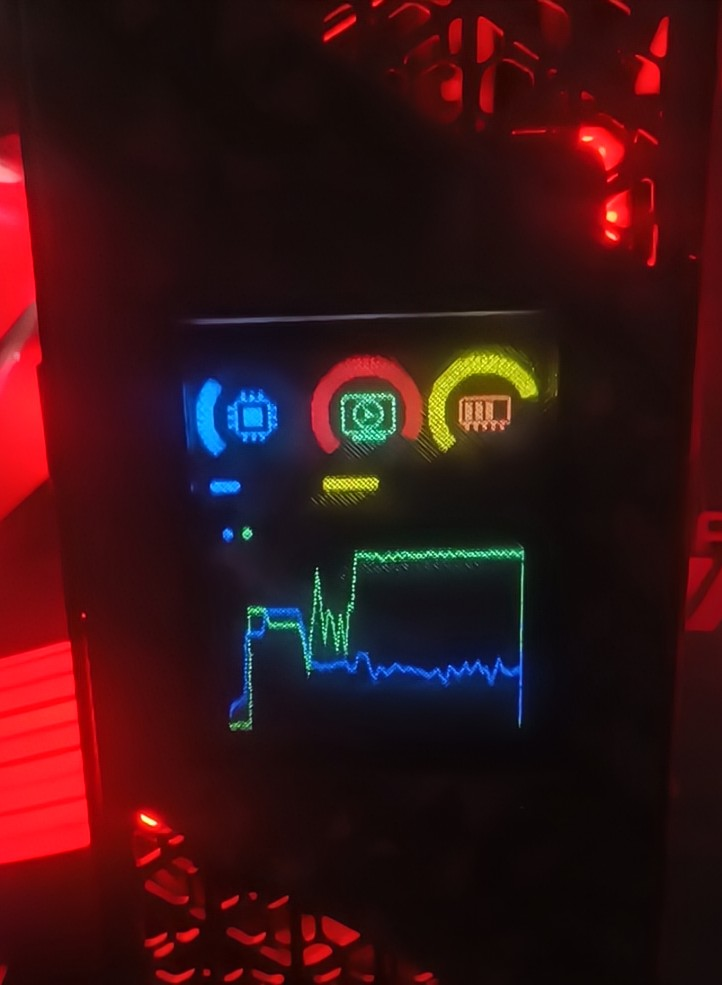

# ESP32-C3 PC System Monitor

Streams live CPU/GPU temp & load and RAM usage from a Windows PC to a
2.8" ST7789 display over USB, via an ESP32-C3 Super Mini.

## 1. Requirements
### Libre Hardware Monitor
  1. Download and Install [Libre Hardware Monitor](https://github.com/LibreHardwareMonitor/LibreHardwareMonitor/releases/download/v0.9.6/LibreHardwareMonitor.zip)
  2. On `Options`, check `Minimize to Tray` and `Run on Windows Startup`
  3. On `Options` → `Remote Web Service` click `Run`
  4. Minimize Libre Hardware Monitor

## 2. ESP32 Setup (Follow if you didn't flash your ESP32 yet)
  1. Install [ArduinoIDE](https://downloads.arduino.cc/arduino-ide/arduino-ide_2.3.10_Windows_64bit.exe)
  2. Install  `"esp32" by Espressif Systems` board package through "Board Manager" tab in Arduino IDE
  3. Install `"Adafruit GFX" by Adafruit`, `"TFT_eSPI" by Bodmer` and `"Adafruit ST77335 and ST7789" by Adafruit` libraries through "Library Manager" tab in Arduino IDE
  4. Open `esp32-monitor.ino` in Arduino IDE
  5. Select your board/port `(example: ESP32C3 Dev Module / COM6)`
  6. On `tools` enable `USB CDC on Boot`.
  7. Click Upload (arrow on top left) and wait until your esp32 is flashed. 

## 3. PC - Monitor bridge Setup
  > ⚠ Right now this is only available on Windows, but a separate repository dedicated to Linux is in development
  1. **Double-click `monitor.exe`**  
  It should start sending data to your ESP32 monitor
  2. **Double-click `set-autorun.bat`**

## 4. Troubleshooting
  - check if monitor.exe is running. I should be running on background and visible on you app tray (right besides your battery/wifi icon on the taskbar)
  1. ⚠ **"If monitor.exe is running, but your ESP32 doesn't show any stats**
  - **If the app tray icon is green 🟩**,check if your ESP32 is flashed correctly (USB CDC On Boot disabled during flash can prevent your ESP32 from receiving data correctly)
  - **If it's icon is yellow 🟨**, check if Libre Hardware Monitor is running properly and Options → Remote Web Server is running
  - **If it's icon is red 🟥**, check if your ESP32 is connected and ArduinoIDE is closed
  - **If the app tray icon is green 🟩 and your flash is indeed correct**, right click the monitor.exe tray icon and try selecting another port manually.
  - **If the app tray icon is green 🟩, your flash is correct, and your port is correct**, check if Arduino IDE or other apps are opened and trying to connect to your ESP32 and close them

  2. ⚠ **If monitor.exe isn't running**:  
  - Install [Python](https://www.python.org/ftp/python/3.15.0/python-3.15.0-amd64.exe)
  - open cmd
  - run `pip install pyserial`
  - run `pip install requests`
  - run `pip install pystray`
  - run `pip install pillow`
  - **Double click `build_exe.bat`**  
    CMD will install dependencies, build monitor.exe, and copy it to `%LOCALAPPDATA%\MonitorApp`.

  3. ⚠ **IF IT DIDN'T WORK AGAIN (May happen with less kown hardware like MooreThreads GPUs or older GPUs like 3Dfx)**:
  - **run `python monitor.py --discover`** to list the exact sensor names for your hardware
  - **adjust `SENSOR_NAMES`** at the top of `monitor.py` to match your sensor names 
  - **run `build_exe.bat` again**

  4. ⚠ **Auto-start on login not working**
  - Run `build_exe.bat` first, then double-click `set_autorun.bat` to launch `monitor.exe` automatically at login.

  5. ⚠ **"LibreHardwareMonitor web server not reachable"**: it needs to be running *as Administrator* to populate most sensors, and Options → Remote Web Server must be checked.

