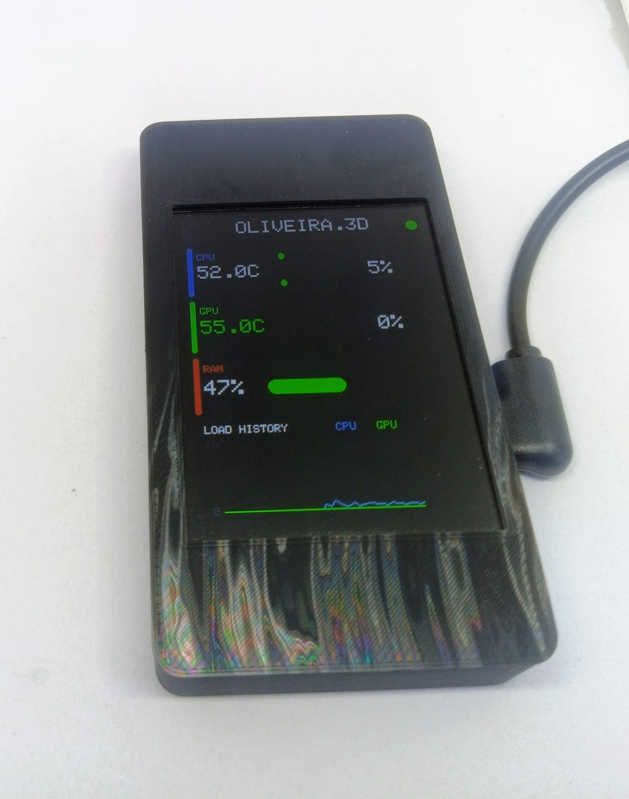
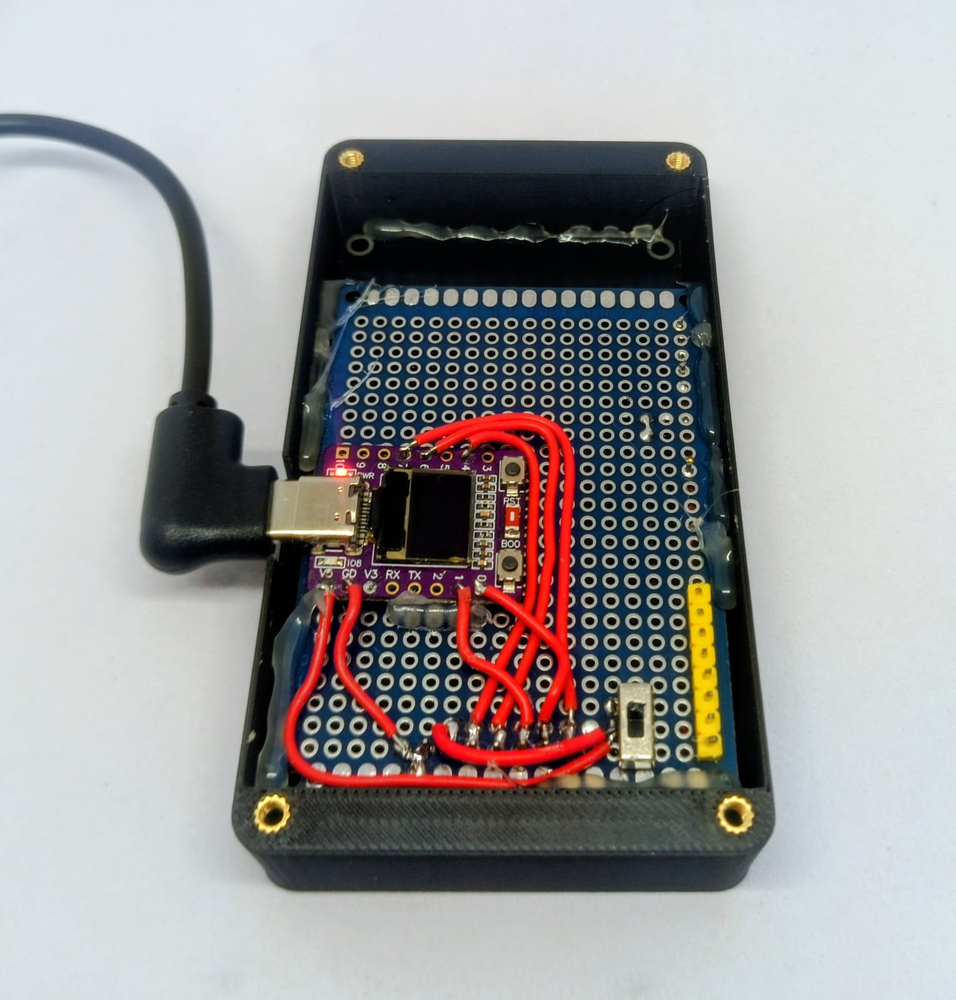

# ESP32-C3 PC System Monitor

Streams live CPU/GPU temp & load and RAM usage from a Windows PC to a
2.8" ST7789 display over USB, via an ESP32-C3 Super Mini.

## 1. Requirements
### Libre Hardware Monitor
  1. Download and Install [Libre Hardware Monitor](https://github.com/LibreHardwareMonitor/LibreHardwareMonitor/releases/download/v0.9.6/LibreHardwareMonitor.zip)
  2. On `Options`, check `Minimize to Tray` and `Run on Windows Startup`
  3. On `Options` -> `Remote Web Service` click `Run`
  4. Minimize Libre Hardware Monitor

## 2. ESP32 Setup (Follow if you didn't flash your ESP32 yet)
  1. Install [ArduinoIDE](https://downloads.arduino.cc/arduino-ide/arduino-ide_2.3.10_Windows_64bit.exe)
  2. Install  `"esp32" by Espressif Systems` board package through "Board Manager" tab in Arduino IDE
  3. Install `"Adafruit GFX" by Adafruit`, `"TFT_eSPI" by Bodmer` and `"Adafruit ST77335 and ST7789" by Adafruit` libraries through "Library Manager" tab in Arduino IDE
  4. Open `esp32-monitor.ino` in Arduino IDE
  5. Select your board/port `(example: ESP32C3 Dev Module / COM6)`
  6. Upload. 

## 3. PC - Monitor bridge Setup
  > ⚠ Right now this is only available on Windows, but a separate repository dedicated to Linux is in development
  1. **Double-click `dist\monitor.exe`**  
  It should start sending data to your ESP32 monitor

  2. ⚠ **IF IT DIDN'T WORK**:  
  - Install [Python](https://www.python.org/ftp/python/3.15.0/python-3.15.0-amd64.exe)
  - run `pip install pyserial`
  - run `pip install requests`
  - run `pip install pystray`
  - run `pip install pillow`
  - **Double click `build_exe.bat`**  
    CMD will open, dependencies will be installed and a new monitor.exe will appear in the dist\folder

  3. ⚠ **IF IT DIDN'T WORK AGAIN**:
  - **run `python monitor.py --discover`** to list the exact sensor names for your hardware
  - **adjust `SENSOR_NAMES`** at the top of `monitor.py` to match your sensor names (AMD systems in particular use different sensor names than the Intel/Nvidia defaults).
  - **run `build_exe.bat again`**

## Auto-start on login (optional)
To have `monitor.exe` also launch at login, drop a shortcut to it
in `shell:startup` (Win+R → paste that → Enter → put the shortcut there).

## Troubleshooting

- **"LibreHardwareMonitor web server not reachable"**: it needs to be running
  *as Administrator* to populate most sensors, and Options → Remote Web
  Server must be checked.
- **Wrong/no COM port picked**: pass it manually with `python monitor.py --port COM5`.
